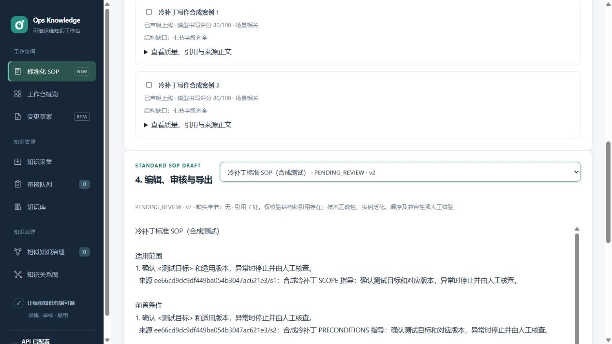
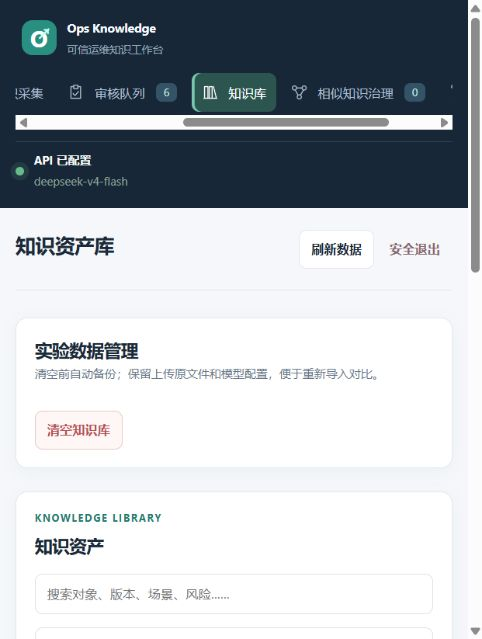
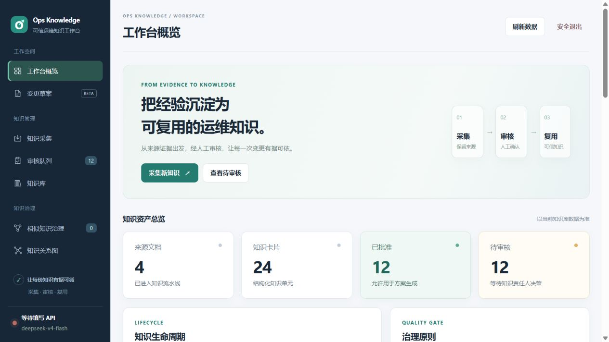
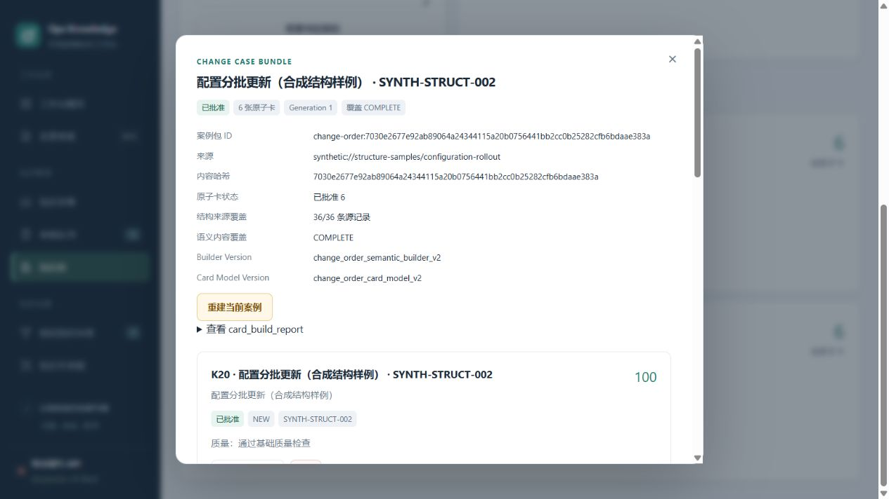
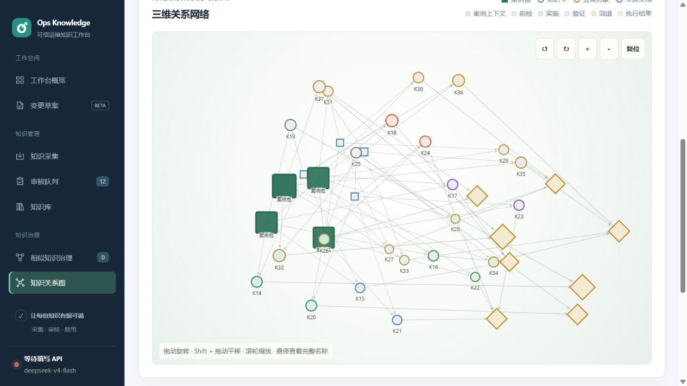
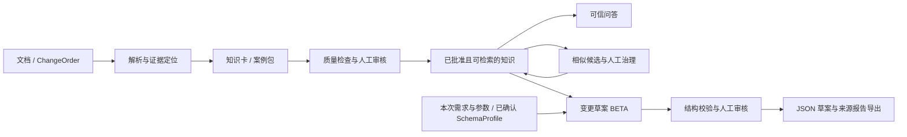

# Ops Knowledge Studio

[](https://github.com/Ptttt1t/ops-knowledge-studio-public/actions/workflows/ci.yml)


**从已上线 SOP 中提取好的写法，编写有来源、可审核的标准 SOP；同时保留运维知识采集与治理能力。**

Ops Knowledge Studio 是一个使用 Python 和 SQLite 的本地运维知识工作台。它将知识采集、案例包审核、可信问答、相似知识治理和变更草案放在同一个界面中，保留从结论回到原始证据的路径。

当前定位是单机能力验证平台。变更草案仍处于 BETA 阶段，支持生成、审核和导出，不执行变更。

> [!IMPORTANT]
> 公开仓库仅使用合成数据。真实 ChangeOrder、知识卡、Prompt、SchemaProfile、评测结果和内部地址只能留在批准的内网环境；外网开发和模型连通性验证使用合成样例。

## 1.9.0 更新

- **标准化 SOP 工作台**：以需求/场景建立批次，批量导入已上线 SOP JSON，复用已知四阶段结构。
- **质量分析与编写**：模型评审六维书写质量，保留优点原文与兼容性说明；人工选择来源后生成七节标准模板，显示逐条引用、缺口和冲突。
- **编辑、审核和导出**：编辑撤销审批，缺口/冲突阻断批准；审核后分别导出 Markdown 和来源 JSON。
- **爬虫接入边界**：提供批次推送接口及目录导入 CLI，便于连接已有内网爬虫；此版本不直接抓取内网网站。
- 沿用 1.8.0 的空库启动、无内置 Mock 和实验清空能力；清空现在也包含标准 SOP 的批次、来源和草案。

## 运行界面

**1.9.0 标准 SOP**：独立合成库中验证分析、生成、批准导出及编辑后重新待审。截图评分和内容来自测试模型固定响应，**不代表真实冷补丁技术内容或真实模型质量**。没有调用外部模型，测试来源不随应用预置。



**1.8.0 实验数据管理**：2026-10-09 在独立合成测试库拍摄的窄屏运行界面。六张待审核卡仅用于本轮测试，不是应用预置数据；“API 已配置”是测试配置状态，没有调用外部模型。



以下历史截图采自 2026-09-09 本地运行的 1.7.0 工作台，使用四份合成结构样例，**不是内网原系统的页面截图**。拍摄时已有 12 张卡获批、12 张待审核；这是该本地库的状态，新安装仍从空库开始。当时模型 API 未配置，草案 BETA 未启用。1.8.0 已移除内置样例入口，截图中的合成数据不随应用预置。

**工作台概览**：汇总来源、知识卡和审核状态。



<details>
<summary>展开查看案例包详情与关系图</summary>

**案例包详情**：查看来源标识、构建版本、覆盖结果和包内知识卡。这里的 `COMPLETE` 表示当前输入与构建规则下的覆盖，不代表真实页面已完整映射。



**知识关系图**：展示这批合成数据的案例包、卡片、业务对象与来源关系；当时共 40 个节点、72 条边。



</details>

## 快速开始

在新电脑接续当前开发，请先阅读[新电脑开发接续指南](docs/NEW_COMPUTER_HANDOFF.md)：当前 1.9.0 功能位于 `codex/standard-sop-studio`，默认克隆的 `main` 尚未包含标准 SOP 工作区。指南包含 Windows PowerShell 命令、环境验收、可选数据迁移、已知问题和新会话接续提示词。

需要 Git 和 Python **3.10–3.13**。CI 覆盖 Windows、Linux 上的这四个 Python 版本。基础应用不需要 Node.js、Docker、Redis 或独立数据库服务。

### 1. 获取代码

```text
git clone --branch codex/standard-sop-studio https://github.com/Ptttt1t/ops-knowledge-studio-public.git
cd ops-knowledge-studio-public
python -m venv .venv
```

Windows 在 **CMD / Anaconda Prompt** 中激活环境并复制配置：

```bat
.venv\Scripts\activate.bat
copy .env.example .env
```

Linux / macOS：

```bash
source .venv/bin/activate
cp .env.example .env
```

### 2. 安装并启动

以下命令均在仓库根目录、已激活的环境中执行：

```text
python -m pip install --upgrade pip
python -m pip install -c constraints/base.txt -e .
python run.py init
python run.py serve
```

打开 [本地工作台](http://127.0.0.1:8765/)。首次启动为空库，可进入“标准化 SOP”批量导入已下载的 JSON，或进入“知识采集”上传其他文档。

停止服务使用终端 `Ctrl+C`，或默认试用模式下的页面“安全退出”。服务会停止接收新任务，并等待在途请求排空。

> `.env.example` 默认使用 `DEMO_MODE=true`，关闭启动令牌、访问令牌和 Host/Origin 检查，仅适用于本机或防火墙隔离的可信环境。这里的 `DEMO_MODE` 是平台试用配置，仍然保留；它不是已删除的模拟执行模块。不要直接暴露到公网。

### 3. 配置模型

在仓库根目录 `.env` 中填写模型服务提供的 API Key、兼容端点和精确模型 ID：

```dotenv
DEEPSEEK_API_KEY=YOUR_API_KEY
DEEPSEEK_BASE_URL=https://api.deepseek.com
DEEPSEEK_MODEL=YOUR_GATEWAY_MODEL_ID
```

将占位符替换为实际配置后重启服务。配置只保存在服务端；不要提交 `.env`。

| 操作 | 模型要求 |
| --- | --- |
| 页面浏览、已有知识审核、关系图、清空知识库 | 不需要模型 API |
| 标准 SOP 导入与结构检查 | 不需要模型 API |
| 标准 SOP 书写质量分析与生成 | 需要模型 API，并显式启用 `STANDARD_SOP_GENERATION_ENABLED=true` |
| 相似知识候选发现 | 本地确定性计算，不调用模型 |
| 普通文档知识抽取、可信问答、草案生成 | 需要可用的模型 API |
| 被识别的结构化 ChangeOrder 导入 | 当前入口仍要求 API 已配置；识别后的卡片构建走确定性路径，不调用模型 |

完整配置见 [.env.example](.env.example)。扫描 PDF 和图片识别需另装 OCR 可选依赖，见[部署指南](docs/deployment.md)。

## 从已下载的 SOP 开始

1. 进入 **标准化 SOP**，建立需求/场景批次，填写关键词、适用产品与版本。
2. 多选 SOP JSON，确认上游上线状态后导入。每批最多 500 份，支持你已下载的 121 份规模；也可用 `sop-import --directory`。
3. 在批准环境配置模型，在 `.env` 开启 `STANDARD_SOP_GENERATION_ENABLED=true` 后重启。点击“分析未完成来源”，查看评分、优点原文和兼容性说明。失败后可再次点击，已成功分析的来源会跳过。
4. 人工选定 1–12 份相关参考，编写标准 SOP。核对七节内容、引用、参数占位符、缺口和冲突，编辑审核后导出。

模型评分不证明技术正确，引用存在也不证明改写正确或不同版本兼容。关键词采集由已有内网爬虫负责，本平台接收结果；接入契约、限制和命令见[标准 SOP 与爬虫对接指南](docs/standard-sop.md)。真实数据与质量评测留在内网。

## 从一份案例走完知识流程

1. **知识采集**：上传文档或粘贴原文。外网开发只使用合成测试资料；真实数据在批准的内网环境中由人工导入。
2. **审核队列**：查看原始证据、字段映射、质量检查和有序步骤。ChangeOrder 按完整案例包审核；导入不会自动批准。
3. **知识库**：查看已审核知识，使用可信问答。系统同时检查发布状态、检索资格和相关性；没有足够证据时会拒绝给出可信回答。
4. **相似知识治理**：检查跨案例的相似候选，决定完整合并、提取共享核心、排除或暂缓。系统不自动合并。
5. **知识关系图**：沿案例、卡片、来源、验证与回退关系检查知识结构。

“工作台概览”汇总资产和审核状态；“变更草案 BETA”是需要单独准备并启用的后续流程。

## 清空知识库后重新实验

在内网实验环境的 `.env` 中显式开启，然后重启服务：

```dotenv
DEMO_MODE=true
DEMO_FULL_RESET_ENABLED=true
```

进入 **知识库 → 实验数据管理 → 清空知识库**，阅读确认提示后执行。默认关闭；生产模式不开放此接口。存在未完成任务、采集、记忆同步、模型请求或后台扫描时，需等待完成或取消相关任务后重试。

清空前，系统将知识库、草案库和任务库备份到知识数据库同级的 `knowledge-reset-backups/<时间-随机标识>/`；备份失败时不删除数据。

| 范围 | 操作结果 |
| --- | --- |
| 来源记录与分片、知识卡、案例包、审核、关系、合并候选和导入缓存 | 清空；同一文件可重新导入，不复用上轮加工结果 |
| 标准 SOP 批次、来源、质量报告和草案 | 清空，纳入同批数据库备份；已导出文件保留 |
| SchemaProfile、实例化变更草案和评测历史 | 保留记录；Profile 停用，变更草案阻断并撤销审批，评测标记失效 |
| 上传原文件、`.env`、API 配置、运行日志、构建报告、历史任务 | 保留；不递归删除目录 |
| 外部 MindMemOS | 立即断开本地引用、保留待清理队列；不宣称已清空外部服务 |

清空后页面重新加载，统计、问答和关系图重新读取空库；再次导入的卡片需要重新审核，卡片 ID 不回退，避免旧引用误指向新卡。清空操作会留下计数和备份位置的审计记录，不会自动删除既有备份。

这不是安全擦除，原文件、备份和历史记录仍在本地。恢复需停服，先保护当前数据，再按[部署指南](docs/deployment.md)恢复同一批备份；不要只替换运行中的数据库文件。单机实验时应只启动一个服务进程，清空期间不要从另一个进程发起任务或导入。

## 已收集的真实变更页面结构

以下根据人工反馈的页面层级、标签、操作流程及脱敏字段报告整理，只描述结构，不包含真实单据值或原系统截图。**页面存在、JSON 中存在、平台已完成映射，是三个不同的确认层次。** 完整对应与缺口见[页面与 JSON 字段对应](docs/change-order-page-field-mapping.md)。

### 案例级信息

为便于阅读，下表按主题归纳已收集的页面标签，不代表原页面的分组名称或排列顺序。

| 信息组 | 已收集的页面信息 |
| --- | --- |
| 单据与人员 | 标题、GOMSC 序列号、工单来源、原始系统单号、当前责任人、抄送人 |
| 分类与场景 | 变更级别、变更环境、变更场景、重大变更、需求来源、备注信息 |
| 服务与范围 | 变更服务；范围中的云服务、微服务组、微服务、Region、Zone、Ring 类型、AZ 类型、Pod、Schema、Hosts；受影响服务详情 |
| 能力与准备 | 手工/自动化/工具化、4号提权方式、变更指导书、变更 SOP 模板、Action & 命令 |
| 内容与影响 | 变更描述、变更影响、客户感知及说明、业务面中断、管理面中断、变更风险等级 |
| 策略与沟通 | 变更灰度、变更回退时间要求、客户授权、通知客户 |

这些标签尚未全部建立精确 JSON 对应。例如，变更环境不能用 Region 代替，微服务组不能直接用 `service` 代替；“4号提权方式”的含义与源键仍未确认。

### 变更实施：四阶段与步骤子页

四阶段路径已确认，阶段内按源顺序组织步骤：

| 页面阶段 | JSON 路径 | 平台阶段 |
| --- | --- | --- |
| 01 操作检测 | `/data/sop_change_step/check_before_change` | `PRECHECK` |
| 02 操作处理 | `/data/sop_change_step/change_implement` | `IMPLEMENTATION` |
| 03 操作验证 | `/data/sop_change_step/change_verified` | `VALIDATION` |
| 04 操作回退 | `/data/sop_change_step/change_rollback` | `ROLLBACK` |

单个步骤内部的页面结构可归纳为：

```text
步骤（名称、顺序、Action 选择、是否有可变参数）
├─ 操作实施：操作内容、操作验证、结果确认、核验说明与图片证据
├─ 影响分析：涉及/不涉及、分析内容、结果确认与证据
└─ 操作回退：涉及/不涉及、回退说明、结果确认与证据
```

真实操作采用 **1+1 check**：执行人逐步操作，配合人逐步核验、截图和回填。异常时停止后续步骤，由人工决定是否回退或采用其他处置。步骤内核验不等于独立的“03 操作验证”阶段；有回退方案不等于已经执行回退。

三个子页各自的确认字段、图片绑定、核验人和时间尚未形成完整映射。当前一个 `is_involved_step` 不能同时代表多个子页的“涉及/不涉及”，更新人员和时间也不能直接解释成执行人或核验人的记录。

<details>
<summary>展开已确认的 20 个步骤字段名</summary>

以下仅按阅读用途分组，不据此推断页面子页归属、JSON 类型或枚举含义。

| 用途分组 | 字段名 |
| --- | --- |
| 步骤身份 | `check_name`、`sop_step_id` |
| 指导内容 | `operate_description`、`operate_verified`、`operate_rollback`、`impact_analysis` |
| 命令与关联 | `operate_commond`、`command_list`、`tool_related_actions`、`action_unique_ids`、`tool_unique_ids` |
| 核验与标记 | `is_involved_step`、`result_confirm`、`result_confirm_notes` |
| 辅助说明 | `label`、`annotation`、`operate_doc_list`、`standardized_items` |
| 更新记录 | `update_time`、`update_user` |

`operate_commond` 保留来源字段拼写。`actions`、`action_risk_level` 是代码中的候选键，不在这份已报告清单内。字段名确认不等于指导内容与事后回填已完成分类。

</details>

### 顶层页面与整单结果

- **顶层“影响分析”**：据人工反馈仍在试运行、当前无人填写，暂不纳入必需覆盖；它与步骤内的影响分析不同。
- **“处理记录”**：记录申请、流转、执行到完成的操作人员与时间；源字段/详情接口尚未确认，不能用单个更新时间代替，也不等于知识卡审核记录。
- **Action 与任务分组**：已确认 `/data/action_list` 和 `/data/change_tool_relate_action` 外层路径；Action 的 13 个字段全表仍待提供，不能将其直接当作有序步骤。
- **整单结果**：已确认 `/data/change_plan/0/result` 路径，平台将其独立构建为 `EXECUTION_OUTCOME` 并排除新变更规划；15 个结果字段全表、`change_plan` 其他字段的业务分类仍待确认。

后续需要补齐的是脱敏字段名、类型、枚举、填写时机和子页归属。测试 fixture 中的暂拟字段不能用于证明这些缺口已解决。

## 知识如何被复用



### 案例与证据保持关联

普通文档经过解析和模型抽取形成知识卡；识别成功的结构化 ChangeOrder 通过 Adapter 和 Card Builder 确定性构建案例包，保留 JSON Pointer、字符区间等来源证据。当前支持文本、Markdown、CSV、JSON、YAML、带文本层的 PDF、DOCX，以及安装 OCR 后的扫描 PDF 和图片。

| 卡片类型 | 用途 | 新变更规划 |
| --- | --- | --- |
| `CASE_CONTEXT` | 案例身份、范围和背景，每个 ChangeOrder 最多一张 | 满足治理条件后可用 |
| `PROCEDURE_STEP` | 前检、实施、验证或回退步骤及其指导 | 满足治理条件后可用 |
| `EXECUTION_OUTCOME` | 历史执行状态、核验与结果证据 | 排除 |

步骤中的 section 默认保留在步骤内，只有满足独立操作条件时才拆分；父卡与子卡不会同时发布到检索。Action 元数据也不会直接被当成有序操作步骤。

### 审核通过之后，仍需满足检索条件

普通可信检索要求知识同时满足 `APPROVED`、`INDEXED` 和 `retrieval_enabled`，并通过证据与相关性检查。审核状态、重复关系、内容质量和发布状态分别保存；批准不等于无条件召回。

相似知识治理只在不同案例、相同阶段之间提出合并候选。同案例不互相合并，跨阶段只建立相似关系。人工可选择完整等价合并，或建立共享核心并保留各案例证据。来源内容或审核状态变化后，关联候选和派生知识会重新校验。

## 变更草案 BETA

目标是用已审核案例辅助编写符合目标结构的草案。该能力默认 `REAL_CHANGE_GENERATION_ENABLED=false`，启用前需要：

1. 准备完整、已批准且语义映射已确认的代表案例。
2. 从案例提取 `SchemaProfile`，人工核对路径、字段、类型和赋值策略，再激活。
3. 配置可用模型，在 `.env` 中开启功能并重启。
4. 填写本次需求和具体参数，确认参考案例后生成、检查并审核草案。

公开环境只用合成数据验证流程。真实案例、Profile 及涉及真实数据的模型调用必须留在批准的内网环境；暂拟测试结构不能替代真实 Schema 确认。

生成时，模型输出独立草案结构，由程序装配目标 JSON 和任务分组视图。历史实例值不能替代本次输入；执行结果、步骤核验、更新人员和时间按策略置空。仅人工批准的 revision 可导出草案及来源报告，生成结果不会自动进入知识库。

**当前仍有已知边界问题**：模型误报本应置空的核验字段缺失时，可能错误阻断审核；旧 revision 的审核/导出路径对空值类型的复核尚不够严格。共享操作者字段也不构成企业身份认证或职责分离。使用前请查看[当前交接状态](docs/CODEX_HANDOFF.md)；启用和操作细节见[草案生成指南](docs/real-change-generation.md)。

## 命令行与开发

Web 和 CLI 共用知识服务。在已激活环境、仓库根目录中可运行：

```text
python run.py ingest --file your-document.md
python run.py list --status PENDING_REVIEW
python run.py case-bundles
python run.py query --question "升级前必须检查什么，失败后如何回退？"
python run.py --help
```

导入后先在 Web 中检查并审核实际卡片或案例包，再执行问答；不要假定卡片 ID 固定。CLI 同样支持审核、案例包查询、SchemaProfile 管理和通用 Harness Run 管理，具体参数以子命令 `--help` 为准。

本地回归与静态检查：

```text
python -m unittest discover -s tests -t . -q
python -m compileall -q harness knowledge_platform tests
node --check knowledge_platform/static/app.js
```

Node.js 仅用于这里的 JavaScript 语法检查，运行平台无需安装。CI 还执行依赖审计和独立 OCR 导入检查，配置见 [CI workflow](.github/workflows/ci.yml)。具体一轮的验证结果记录在交接文档中。

## 数据、部署与升级

平台使用 Python HTTP 服务、原生 HTML/CSS/JavaScript 和本地 SQLite。知识关系图是 SQLite 实体与关系的可视化投影；可选 MindMemOS 默认关闭，启用内容外发还需独立授权开关，召回结果仍需映射回本地知识复核。

| 位置 | 内容 |
| --- | --- |
| `harness/` | 模型客户端、配置、持久化任务、检查点与工具审批 |
| `knowledge_platform/` | 解析、卡片构建、治理、检索、草案和 Web |
| `tests/` | 合成 fixture 与自动化回归 |
| `data/knowledge.db` | 文档、知识卡、案例包、证据、审核关系及标准 SOP 批次/来源/草案 |
| `data/runtime.db` | 通用任务、步骤、事件和审批记录 |
| `data/change_drafts.db` | SchemaProfile、草案版本和评测记录 |
| `knowledge_sources/uploads/` | 上传的原始文件 |
| `artifacts/` | 本地日志、构建报告和诊断工件 |

升级前先停止服务并备份 `.env`、数据库及上传文件；升级代码后按依赖约束重新安装并验证。**移除内置样例不会自动删除部署数据库中的旧案例。** 如需开始新一轮实验，显式启用并使用“清空知识库”；如只需处理一个来源，继续使用案例级治理功能。

正式部署还需组织身份、权限、HTTPS、备份和容量验证。默认试用配置及共享审核人字段不能代替这些工作；当前也没有生产 CMDB、工单或真实执行系统集成。不要把数据库、凭据、上传文件、真实内网数据或运行工件提交到 GitHub。

## 进一步阅读

| 文档 | 内容 |
| --- | --- |
| [新电脑开发接续指南](docs/NEW_COMPUTER_HANDOFF.md) | 当前分支、环境重建、验证、可选数据迁移、待办与新会话提示词 |
| [标准 SOP 与爬虫对接](docs/standard-sop.md) | 批量 JSON、质量分析、编写审核、CLI 与爬虫推送契约 |
| [部署指南](docs/deployment.md) / [安全加固](docs/security-hardening.md) | 安装、OCR、配置、访问控制与部署边界 |
| [ChangeOrder 知识卡构建](docs/structured-change-order-extraction.md) | Adapter、证据、语义单元和质量报告 |
| [字段对应与缺口](docs/change-order-page-field-mapping.md) | 已确认结构、暂拟信息和待验证项 |
| [相似知识治理](docs/semantic-governance.md) | 候选簇、完整合并、共享核心与失效规则 |
| [草案生成与盲测](docs/real-change-generation.md) | SchemaProfile、生成、审核、导出和评测 |
| [MindMemOS 接入](docs/mindmemos-integration.md) | 可选长期记忆和内容外发边界 |
| [项目上下文](docs/CODEX_CONTEXT.md) / [设计决策](docs/DECISIONS.md) | 稳定架构、业务约束与设计原因 |
| [当前交接状态](docs/CODEX_HANDOFF.md) | 最近验证、已知问题和后续工作 |
