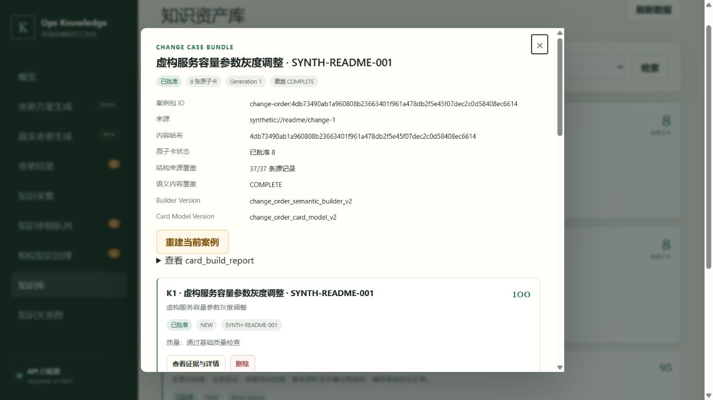
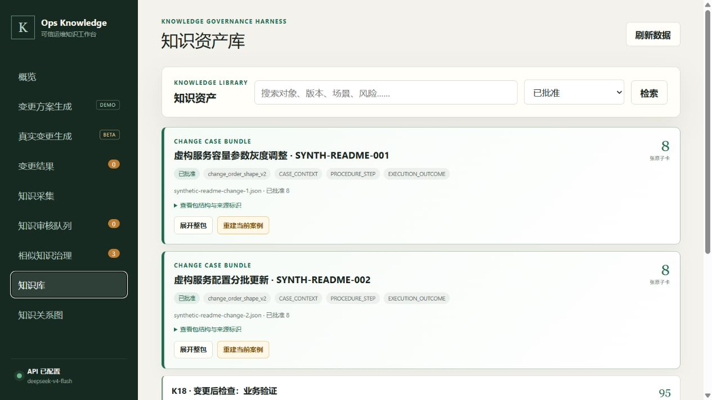
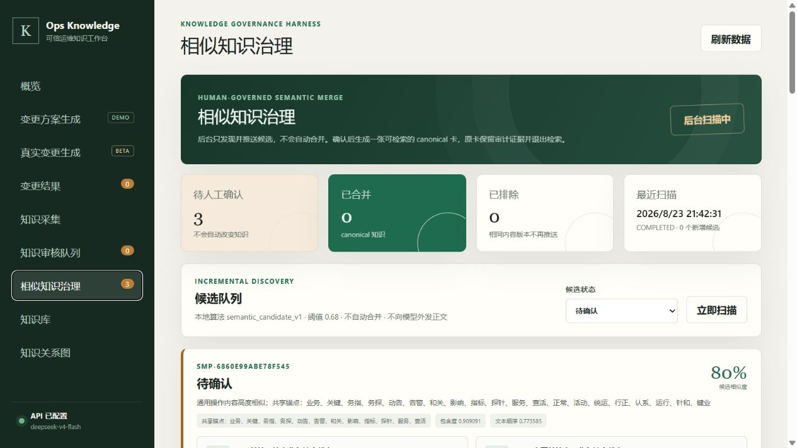
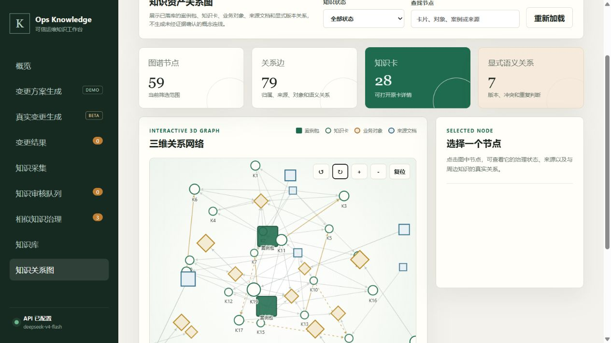
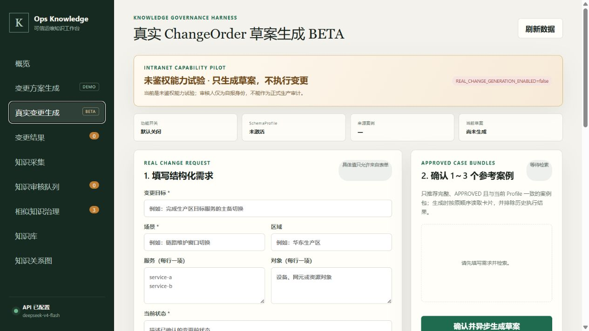
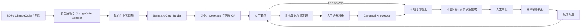

# Ops Knowledge Studio

[](https://github.com/Ptttt1t/ops-knowledge-studio-public/actions/workflows/ci.yml)


一个面向运维场景的本地知识治理与可信变更工作台。它把 SOP、ChangeOrder、复盘和历史方案加工为可审核、可追溯、可检索的知识资产，再用这些已批准知识辅助生成变更草案和安全建议。

工作台将证据定位、知识建模、人工审核、可信检索、相似知识治理和草案审核连成一条可追溯的工作流程。

> [!IMPORTANT]
> 仓库中的工单号、服务名、资源标识、网络地址、人员、指标和执行结果全部是合成演示数据。默认版本不会连接真实云账号、CMDB、监控、工单或执行系统，也不接受真实云凭据。

## 为什么需要它

生产运维中的知识辅助不能只回答“资料里写了什么”，还必须回答：

- 这条知识是否经过人工审核？
- 当前结论引用了哪张卡、哪个字段和哪段来源？
- 历史执行结果是否被错误地当成当前规划依据？
- 具体设备 ID、IP、阈值和版本来自用户输入，还是模型猜测？
- 两张表述不同的检查卡是否其实是一条可复用知识？
- 草案是否保留回退指导，是否误用了历史人工核验结果？
- 代码升级后重建同一案例，旧卡、旧索引和旧合并关系是否真的失效？

Ops Knowledge Studio 的回答是：把这些问题变成明确的数据模型、状态流、硬门禁和人工决策点。

## 当前能力地图

| 模块 | 已实现能力 | 关键边界 |
| --- | --- | --- |
| 文档采集 | 文本、Markdown、CSV、JSON、YAML、PDF、DOCX、图片/OCR | 文档大小、页数、解压比、像素和模型调用次数受限 |
| ChangeOrder Adapter | 结构指纹、真实路径、JSON Pointer、字符区间、SHA-256 证据 | Schema 冲突时失败关闭，不把疑似工单交给模型猜 |
| Knowledge Card Builder | `CASE_CONTEXT`、`PROCEDURE_STEP`、`EXECUTION_OUTCOME` | Extraction Unit 不等于 Knowledge Card；正文禁止 raw JSON |
| 案例包 | 一个 ChangeOrder 对应一个 `ChangeCaseBundle`，包内保存有序卡片 | 支持整包原子审核和当前案例精确重建 |
| 知识治理 | 质量 QA、证据复核、批准、驳回、替代、重复状态 | 只有 `APPROVED + INDEXED + retrieval_enabled` 可进入可信检索 |
| 相似知识治理 | 同案例隔离、跨案例 complete-link 知识簇、人工完整合并或共享核心 | 跨阶段只建关系；同案例不进入合并队列；不调用模型 |
| 知识关系图 | 案例、卡片、对象、来源、版本、验证、回退、相似和合并关系 | 当前是 SQLite 关系投影与可视化，不是独立图数据库 |
| 可信问答 | 本地混合检索、字段级引用、可选只读 Agent | 无强相关已审核证据时拒绝输出“可信方案” |
| 真实 ChangeOrder BETA | 结构化需求、完整案例推荐、草案生成、留版、审核、JSON 导出、盲测 | 默认关闭；只生成草案，不注册真实执行工具 |
| Harness Runtime | SQLite Run、步骤、事件、检查点、幂等、取消、恢复、工具审批 | 参数、预算或审批上下文漂移会使旧授权失效 |
| MindMemOS | 可选的跨表述语义后备与长期记忆同步 | 默认关闭；内容外发需第二个显式开关；结果仍回到本地复核 |

## 产品界面

以下为历史版本的合成数据功能截图；1.7.0 已统一更新导航与视觉样式，以本地工作台为准。截图不包含真实 ChangeOrder 或内网信息。

### 1. ChangeOrder 以案例包为整体治理

一个完整 ChangeOrder 先建立案例包，再生成最多一张 Context、逐源 Procedure 和独立 Execution Outcome。页面同时显示结构覆盖、语义覆盖、Builder 版本、Card Model 版本和重建入口。



案例包在知识库中是一级资产，而不是十五张彼此失联的卡片：



### 2. 相似知识由系统发现、由人决定

后台会持续比较已批准 Procedure 卡，把不同案例包中的相似知识整理成 N 成员候选簇。同一案例包内的卡片不会互相进入合并队列。操作者可以查看簇代表、全部成员、最低/平均相似度和关键差异；三成员以上的候选可先逐张移除误入成员，再选择完整合并、建立共享核心、排除或暂缓。



完整等价合并会创建 canonical 卡并建立 `MERGED_INTO`；共享核心治理会保留各案例卡作为 `CASE_EVIDENCE`，并建立 `INSTANCE_OF`。两种方式都避免 canonical 与来源成员同时进入普通检索。不同阶段即使文本一致，也只建立 `CROSS_PHASE_SIMILAR`。

### 3. 用关系图检查知识结构

三维关系图展示案例包、知识卡、业务对象、来源文档，以及 `VALIDATES`、`ROLLBACK_OF`、`DUPLICATE_OF`、`SIMILAR_TO`、`CROSS_PHASE_SIMILAR`、`MERGED_INTO`、`INSTANCE_OF` 等显式关系。布局采用类型质心与局部力导向：Context、前检、实施、验证、回退和执行结果形成不同空间簇，关系边仍参与位置调整。拖动可旋转视角，Shift + 拖动可平移，滚轮可缩放；节点只常驻显示短标识，完整名称在悬停浮层和右侧详情中查看。



这里的“知识图谱”是 SQLite 中实体和关系的交互式投影，适合治理检查、来源追踪和关系浏览；当前没有引入 Neo4j 等独立图数据库，也不声称具备开放世界图推理能力。

### 4. 真实 ChangeOrder 生成是隔离的 BETA 能力

真实生成页面与合成执行 Demo 分开。功能默认关闭，页面持续显示“未鉴权能力试验”和 `REAL_CHANGE_GENERATION_ENABLED` 状态。



它只生成和审核 JSON 草案，不执行变更；所有具体值必须来自结构化表单参数，缺失值以占位符暴露并阻断审核。

### 5. 四份结构样例

知识采集页提供容量调整、配置更新、证书轮换、阈值调整四份合成 JSON，支持预览、下载和标准导入。四阶段和步骤 20 个字段名使用已确认信息；Action/整单结果的字段及部分类型暂拟，不能作为真实接口契约。导入后的案例包仍需人工审核。

样例文件与确认边界见 [合成结构样例](knowledge_platform/static/samples/README.md)。旧合成执行 Demo、模拟路由和十案例目录已移除；可信问答移动到知识库。

## 核心架构



系统坚持四个分层：

1. **事实层**：原始文档、JSON Pointer、字符范围和 SHA-256。
2. **知识层**：Card Type、业务字段、通用操作、实例参数和语义关系。
3. **治理层**：审核、去重、发布、质量、合并和索引状态。
4. **变更层**：需求、计划、硬校验、审批、执行、验证和回退。

模型负责语言理解与有限生成；时间戳、时长、布尔值、枚举、数值、资源规格、版本、任务双视图对账和审批绑定由程序确定性处理。

## ChangeOrder 如何变成知识

当前流水线：

```text
ChangeOrder JSON
→ ChangeOrder Adapter
→ normalized business objects
→ ProcedureStep normalization
→ semantic unit building
→ dedup / reuse
→ Knowledge Card
→ QA + review + index
```

### Card Type

| Card Type | 语义 | 默认进入规划 RAG |
| --- | --- | --- |
| `CASE_CONTEXT` | 工单身份、服务范围、区域、窗口、治理、风险影响、灰度、工具与 Action metadata | 是 |
| `PROCEDURE_STEP` | 一个规范化 source ProcedureStep，包含 operation、validation、rollback、impact | 是 |
| `EXECUTION_OUTCOME` | 历史执行状态、验证记录、失败原因和结果反馈 | 否 |

关键建模规则：

- 每个 ChangeOrder 最多生成一个 `CASE_CONTEXT`。
- `/data/action_list` 是 Action/Capability metadata，不是有序 Procedure。
- 默认 `1 source ProcedureStep = 1 retrievable Procedure Knowledge Unit`。
- section 默认保存在 `operation_sections[]`；只有步骤确实过长且 section 可独立操作时才发布 child。
- Parent 和 Child 绝不同时 `INDEXED`；拆分后 Parent 是 `CONTAINER`。
- HTML、实体、图片和 JSON escape 经过 `normalize_rich_text()`；图片只保留 attachment/evidence metadata。
- `impact_analysis`、`risk_level`、`risk_control` 和 `inferred_risk` 分开建模。
- `generalized_operation` 与 `instance_parameters` 分层，历史参数只作为案例证据。
- 高置信 target/value 关系可以建立 `VALIDATES` 和 `ROLLBACK_OF`。
- `action_list` 与 `change_tool_relate_action` 使用稳定 JSON serialization 和 SHA-256 multiset reconciliation 对账。

每次构建会输出 `card_build_report.json`，包含结构覆盖、语义覆盖、Parent/Child 发布、noop section、重复复用、标题冲突、关系数量、逐卡 QA 和 `skip_reason`。示例见 [card_build_report.example.json](docs/card_build_report.example.json)。

业务字段以经人工确认的真实结构为准，公开测试仍只使用合成值。早期仅模拟外层路径和字段数量的五份 JSON 案例及其专用生成、评估入口已退役；结构测试通过不代表覆盖真实页面全部信息。当前字段对照和缺口见 [变更单页面与 JSON 字段对应](docs/change-order-page-field-mapping.md)。旧合成执行 Demo 已退役；真实草案仍不注册或调用执行工具。

## 知识状态不是一个字段

平台将过去容易混淆的状态拆开：

| 状态 | 回答的问题 | 示例 |
| --- | --- | --- |
| `review_status` | 人是否批准了这条知识？ | `PENDING_REVIEW` / `APPROVED` |
| `dedup_status` | 它与其他知识是什么关系？ | `NEW` / `DUPLICATE` / `CANONICAL` / `MERGED` |
| `content_quality` | 正文和证据质量如何？ | `0–100` |
| `publish_status` | 它应以何种形态发布？ | `CANDIDATE` / `INDEXED` / `CONTAINER` / `SKIPPED` |
| `retrieval_enabled` | 普通检索能否召回？ | `true` / `false` |
| `planning_rag_enabled` | 能否进入新变更规划？ | Execution Outcome 固定为 `false` |

这意味着“已批准”不等于“一定进入检索”，“重复”也不会再与质量分或审核状态混为一谈。

## 跨案例相似知识簇治理

启用后，Web Server 会启动有界后台扫描器：

```dotenv
SEMANTIC_GOVERNANCE_ENABLED=true
SEMANTIC_SCAN_INTERVAL_SECONDS=3600
SEMANTIC_PROPOSAL_MIN_SCORE=0.68
SEMANTIC_SCAN_MAX_CARDS=500
SEMANTIC_SCAN_MAX_PROPOSALS=100
```

处理流程：

```text
APPROVED + INDEXED Procedure Cards
→ 读取 card_lineage.case_id
→ 同案例 pair: SKIP
→ 跨案例、同 procedure_group: 本地确定性相似度
→ complete-link 知识簇 + PENDING_REVIEW + SIMILAR_TO
→ 人工 REMOVE_MEMBER（可选窄化）/ FULL_EQUIVALENT / SHARED_CORE / REJECT / DEFER
→ canonical + MERGED_INTO / INSTANCE_OF

跨 procedure_group
→ CROSS_PHASE_SIMILAR（保留两张阶段卡，不进入合并队列）
```

- 扫描不调用 LLM，也不会把正文发送给外部模型。
- 分数只是候选门槛，不是合并结论。
- `case_id` 是硬隔离边界；一个知识簇中每个案例最多一张卡。
- `procedure_group` 是硬约束；PRECHECK、IMPLEMENTATION、VALIDATION、ROLLBACK 之间禁止直接合并。
- complete-link 要求簇内任意两张成员卡均达到阈值，避免传递相似导致过度合并。
- 页面共享锚点来自结构化字段和完整业务短语，不展示中文字符滑窗片段。
- `REJECTED` 与成员 case/card/fingerprint 组合绑定；内容不变时不重复推送。
- 接受前移除成员会保留原簇为 `SUPERSEDED`，按 procedure group 与 card/case/fingerprint 记录 pair 排除，并原子创建剩余成员的新待审核簇；来源卡此时不退出检索。
- 内容或审批状态变化后旧候选自动 `STALE`。
- 完整合并与共享核心都在单个 SQLite 事务中完成，来源成员立即退出普通检索和长期记忆映射。
- 重建任一来源案例会链式下架派生 canonical，恢复仍有效的其他来源卡。

完整说明见 [相似知识人工合并治理](docs/semantic-governance.md)。

## 快速开始

### 环境要求

- Python `3.10–3.13`
- Git
- Windows、Linux 或 macOS
- DeepSeek 兼容 API：知识抽取、可信回答和真实草案生成需要；样例预览和已有知识浏览不需要
- 可选 OCR：PaddleOCR、PaddlePaddle、PyMuPDF

### Windows + Conda

```bat
conda create -n ops-knowledge-studio python=3.10 -y
conda activate ops-knowledge-studio
git clone https://github.com/Ptttt1t/ops-knowledge-studio-public.git
cd ops-knowledge-studio-public
python -m pip install --upgrade pip
python -m pip install -c constraints/base.txt -e .
copy .env.example .env
python run.py init
python run.py serve
```

### Linux / macOS

```bash
conda create -n ops-knowledge-studio python=3.10 -y
conda activate ops-knowledge-studio
git clone https://github.com/Ptttt1t/ops-knowledge-studio-public.git
cd ops-knowledge-studio-public
python -m pip install --upgrade pip
python -m pip install -c constraints/base.txt -e .
cp .env.example .env
python run.py init
python run.py serve
```

打开 <http://127.0.0.1:8765>。

`.env.example` 默认采用内网 Demo 模式，关闭启动令牌、访问令牌和请求边界检查；它适合本机或防火墙隔离的可信内网体验，不是公网部署模板。

## 建议的首次体验

### 路线 A：浏览合成结构样例

打开“知识采集”，预览或下载四份合成 JSON。使用标准导入后，在审核队列查看整包证据和有序步骤；未批准的案例不会进入可信生成上下文。Action 与整单结果字段尚待内网确认。

### 路线 B：导入知识并走审核闭环

在 `.env` 中填写服务端 API 配置：

```dotenv
DEEPSEEK_API_KEY=YOUR_API_KEY
DEEPSEEK_BASE_URL=https://api.deepseek.com
DEEPSEEK_MODEL=deepseek-v4-flash
```

然后：

```powershell
python run.py ingest --file sample_data/demo_upgrade_sop.md
python run.py list --status PENDING_REVIEW
python run.py review --id 1 --action approve --reviewer knowledge-owner
python run.py query --question "升级前必须检查什么，失败后如何回退？"
```

对于结构化 ChangeOrder，建议在 Web 页面查看和审核整个案例包，而不是逐张卡片操作。

## 真实 ChangeOrder 草案生成 BETA

这条能力默认关闭，并与合成执行 Demo 完全隔离。启用前必须从一份已批准的代表案例提取、人工检查并激活 `SchemaProfile`：

```powershell
python run.py change-schema-profile-inspect --case-id "change-order:<source-sha256>" |
  Out-File -Encoding utf8 .\schema_profile.json

python run.py change-schema-profile-activate `
  --file .\schema_profile.json `
  --actor schema-admin

python run.py change-schema-profile-show
```

确认 Profile 后，在可信内网 `.env` 中开启：

```dotenv
REAL_CHANGE_GENERATION_ENABLED=true
CHANGE_DRAFT_DB_PATH=data/change_drafts.db
CHANGE_GENERATION_MAX_CASE_BUNDLES=3
CHANGE_GENERATION_MAX_CONTEXT_CARDS=24
CHANGE_GENERATION_MAX_OUTPUT_TOKENS=8192
# 真实草案专用等待上限；可按内网实测调整，不影响普通模型请求。
CHANGE_DRAFT_TIMEOUT_SECONDS=240
DEEPSEEK_MODEL_MAX_CONCURRENCY=2
CHANGE_DRAFT_MODEL_MAX_CONCURRENCY=1
# 可选；填写网关实际接受的 Qwen model ID，不要照抄展示名称。
CHANGE_DRAFT_FALLBACK_MODEL=
CHANGE_DRAFT_FALLBACK_MODEL_MAX_CONCURRENCY=2
```

生成流程：

```text
RealChangeRequest
→ 输入/Profile 确定性绑定预检
→ 推荐并人工确认 1–3 个完整 APPROVED 案例包
→ GeneratedChangeDraft
→ 程序确定性装配真实 JSON
→ 硬门禁
→ 人工审核
→ change_order_draft.json + provenance_report.json
```

主要门禁：

- 没有激活且结构一致的 Profile 时禁止生成。
- 当 Profile 将 `change_scene` 定义为对象时，页面分别收集场景中文名、英文名和唯一标识，并按 Profile `sample` 的键和子字段类型确定性装配；`sample` 只用于描述结构，绝不复制其中的历史值。旧 API 客户端也可通过 `parameters.change_scene` 传入同一对象。
- 场景英文名、唯一标识等 Profile 样例中原本非空而本次未提供的字段会写类型安全空值并进入缺失项硬门禁，不会从历史案例补值。
- 案例包必须完整读取；超出上下文预算时要求减少案例，不静默截断。
- 所有具体值必须来自表单；无来源参数直接失败。
- `Profile.type=null` 的字段必须存在并保持 JSON `null`，这是合法结构值，不计入 `missing_fields`；字段缺席或非 null 类型为空仍会阻断。场景英文名、唯一标识等 string 输入不会因这条规则被放行。
- “本次变更具体参数 JSON”会原样进入 `request.parameters`。新 IP、账号、端口、阈值和资源规格必须在这里填写；为空时页面会二次确认，模型不得从参考案例的 `instance_parameters` 复制旧值。
- `action_list` 是唯一任务主视图，分组视图由程序派生并对账。
- `ExecutionResult` 只能保持空值或 `NOT_EXECUTED`。
- 步骤内的 `result_confirm`、`result_confirm_notes`、`update_user`、`update_time` 不是模型所有字段：新旧 Profile 在生成和编辑时都会被确定性改为空值，最终硬门禁再次检查，避免草案虚构人工核验、人员或时间。
- 只有已收到响应正文且模型负责的 JSON 或 `GeneratedChangeDraft` 协议不合规时才允许一次协议修复。请求/Profile 输入绑定会在模型调用前预检，错误码为 `REQUEST_PROFILE_BINDING_ERROR`；这类确定性错误即使在装配阶段暴露也立即停止，绝不发送第二个远程请求。超时、连接失败和 HTTP 错误同样立即停止，也不生成规则 fallback 草案。
- 普通模型请求继续使用 `DEEPSEEK_TIMEOUT_SECONDS`（默认 120）；真实草案单独使用 `CHANGE_DRAFT_TIMEOUT_SECONDS`（默认 240）。修改实际 `.env` 后重启服务即可调整草案上限，不会同时放宽知识抽取和问答。
- 同一进程按 base URL、API Key 指纹和实际模型建立共享门禁；主模型普通路径最多并发 `DEEPSEEK_MODEL_MAX_CONCURRENCY=2`。真实草案在所选模型路由上申请独占槽位，不与本进程内同模型的抽取、问答或其他 Runtime Worker 请求重叠。
- 真实草案任务之间的最大并发固定为 `CHANGE_DRAFT_MODEL_MAX_CONCURRENCY=1`，且关闭底层隐藏 HTTP 重试。若主模型返回 HTTP 429、`count/limit` 或等价容量错误，并且配置了 `CHANGE_DRAFT_FALLBACK_MODEL`，程序才用同一端点和凭据尝试备用模型一次；超时不会自动重试或切换模型，因为供应商侧原推理可能仍未结束。
- 每个 revision 的 `model_usage.model_routing` 记录实际模型、是否回退和尝试顺序；全库模式与盲测报告因此可按模型区分。`/api/health.model_requests.routes` 显示各模型路由的活动/等待请求、峰值和独占状态。
- 草案及 Runtime checkpoint 只保存非敏感生成统计：模型、等待上限、案例/卡片计数、Prompt 字符/字节数、输出预算、请求起止时间、耗时、请求数、响应大小，以及供应商确实返回时的 token usage；不保存真实 Prompt 正文。超时使用 `MODEL_TIMEOUT`，并明确提示本次未自动重试。
- `generation_diagnostics.protocol_repairs` 记录发生第二次模型调用前的阶段、错误码和截断原因；nullable missing 只影响最终门禁，不会触发协议修复。
- 只有当前 `REVIEW_APPROVED` revision 可以导出。
- 留一案例盲测会在生成期间隔离目标及内容近重复案例。

完整说明见 [真实 ChangeOrder 草案生成与能力盲测](docs/real-change-generation.md)。

## Demo 中重建当前案例

在 `DEMO_MODE=true` 且 `DEMO_REBUILD_ENABLED=true` 时，案例包详情会显示“重建当前案例”。该操作：

- 保留原始上传 JSON、source file 和 `source_sha256`；
- 精确清除当前 case 的卡片、审核、关系、fingerprint、索引、缓存和旧报告；
- 失效依赖这些卡片的相似候选与 canonical 合并结果；
- 强制以当前 Adapter 和 Builder 重新运行；
- 使用新的单调递增 K ID，并增加 `build_generation`；
- 不影响其他案例，也不关闭普通 ingest 的幂等机制。

手动删除单张卡片也会在同一 SQLite 事务中失效包含它的知识簇、清理簇内相似关系，并下架已接受簇的派生 canonical。其他来源卡只有在不受其他有效治理结果约束时才恢复检索。

`DEMO_FULL_RESET_ENABLED` 当前保留但默认关闭，Web 未开放全库重置入口。

Demo 配置遵循“安全功能默认开启”原则：`DEMO_MODE=true` 且未显式配置新功能开关时，非破坏性的 Demo 能力默认可用。全库重置、真实业务数据模型调用等破坏性或敏感能力仍默认关闭，分别受 `DEMO_FULL_RESET_ENABLED=false`、`REAL_CHANGE_GENERATION_ENABLED=false` 保护。

## Demo 安全退出

`DEMO_MODE=true` 且 `DEMO_SAFE_SHUTDOWN_ENABLED=true` 时，页面右上角显示“安全退出”。确认后平台会：

- 立即进入 `DRAINING` 并拒绝新的写操作、生成任务和 Runtime Run；
- 请求相似治理 Worker、主 Runtime 和合成 Demo Runtime 停止领取新任务；
- 持续显示在途 Web 操作、模型请求和 Worker 数量；
- 等所有模型 HTTP 请求自然返回或达到客户端超时、后台任务退出后，才关闭 HTTP 服务。

不要把关闭浏览器页面当作停止平台，也不要在模型请求仍运行时直接关闭终端。`Ctrl+C` 现在也会执行同一排空流程，但页面按钮能提供更直观的进度。当前相似知识后台扫描是本地确定性计算，不调用大模型；API 并发通常来自抽取、问答、真实草案或启用模型的合成 Demo。

## 可选 MindMemOS 长期记忆

MindMemOS 是本地检索无强命中时的实验性语义后备，不替代 SQLite 知识库和审核状态。

```dotenv
MINDMEMOS_ENABLED=true
MINDMEMOS_BASE_URL=http://127.0.0.1:8000
MINDMEMOS_API_KEY=LOCAL_MEMORY_API_KEY
MINDMEMOS_USER_ID=ops-knowledge-studio
MINDMEMOS_APP_ID=ops-knowledge-studio
MINDMEMOS_MIN_RELEVANCE_SCORE=0.65
MINDMEMOS_MIN_LOCAL_ANCHORS=2

# 完成数据边界确认后再单独开启
MINDMEMOS_ALLOW_CONTENT_EXPORT=true
```

可信门禁：

- 只同步本地 `APPROVED` 且可检索的卡片。
- 外发字段采用白名单，不包含 `source_ref`、`evidence_locator`、原始证据正文或本地路径。
- 返回的自由文本不直接进入答案，只使用 `memory_id` 映射回本地 card ID。
- 每次召回重新检查本地状态、内容哈希、相关性、对象和动作锚点。
- 外部服务失败时降级到本地检索。

详见 [MindMemOS 长期记忆实验接入](docs/mindmemos-integration.md)。

## 常用 CLI

```text
init                         初始化 SQLite
serve                        启动 Web 工作台
ingest                       导入并加工文档
list / show                  查看卡片
review                       审核、驳回或替代卡片
case-bundles / case-bundle   查看 ChangeOrder 案例包
review-case-bundle           原子地审核整个案例包
search                       本地治理检索
query / agent-query          可信回答与只读 Agent
change-schema-profile-*      管理真实生成 SchemaProfile
memory-status / memory-sync  检查或同步 MindMemOS
run-*                        管理持久化 Harness Run
```

查看完整参数：

```powershell
python run.py --help
python run.py run-submit --help
```

## 数据与目录

```text
harness/                DeepSeek 客户端、配置、Runtime、Tool Registry
knowledge_platform/     文档解析、Adapter、Card Builder、治理、检索、Web
sample_data/            合成 SOP 和独立 Demo 案例文档
tests/fixtures/         合成测试数据；ChangeOrder 业务字段见专项说明
knowledge_sources/      知识来源与公开测试语料
scripts/                诊断、评估、导入和实验脚本
docs/                   部署、安全、ChangeOrder、MindMemOS 与专题文档
data/                   SQLite 数据库，默认不提交
artifacts/              运行、报告、审计与模拟执行工件，默认不提交
```

主要持久化边界：

- `data/knowledge.db`：文档、卡片、证据、案例包、关系、审核与记忆映射。
- `data/runtime.db`：Run、步骤、事件、检查点和工具审批。
- `data/change_drafts.db`：SchemaProfile、真实草案 revision 和盲测报告。
- `artifacts/change_order_card_reports/`：逐案例 `card_build_report.json`。

## 测试与验证

```powershell
python -m unittest discover -s tests -t .
python -m compileall -q harness knowledge_platform tests
node --check knowledge_platform/static/app.js
```

当前分支回归结果：`162 tests passed`。

测试覆盖：

- ChangeOrder 结构识别、动态 action group 和双视图 reconciliation；
- Card Type、rich text、确定性时间戳、section publication 和跨阶段复用；
- 案例包审核、证据漂移、内容 QA 和 case-scoped rebuild；
- 相似候选、拒绝抑制、人工 canonical 合并、图谱变化和重建失效；
- 真实草案推荐、Profile、留版、审核、导出、盲测和模型协议失败；
- Runtime 幂等、预算、审批、取消、恢复和并发；
- Web 鉴权、请求边界、文档炸弹防护和长期记忆治理。

CI 配置见 [.github/workflows/ci.yml](.github/workflows/ci.yml)。

## 部署与安全边界

默认 Demo 只适合本机或防火墙隔离的可信内网。正式部署至少需要：

```dotenv
DEMO_MODE=false
STARTUP_TOKEN_REQUIRED=true
ACCESS_TOKEN_REQUIRED=true
PLATFORM_AUTH_MODE=token
PLATFORM_REQUEST_BOUNDARY_CHECKS_ENABLED=true
PLATFORM_CSP_ALLOW_INLINE=false
DEEPSEEK_ALLOW_INSECURE_HTTP=false
```

生成访问令牌摘要：

```powershell
python run.py generate-access-token
```

并确保：

- 使用 HTTPS 反向代理和真实身份鉴权；
- API Key 只保存在服务端配置，不写入日志、前端或仓库；
- 真实 ChangeOrder、SchemaProfile、Prompt、数据库和评测结果不提交公开仓库；
- `REAL_CHANGE_GENERATION_ENABLED` 只在内网完成 Profile 和模型检查后开启；
- 不把 Demo 的共享操作者字段当成正式审计身份；
- 不为 BETA 模块注册真实执行工具；
- 对 SQLite、`artifacts/` 和报告目录设置备份、权限与保留策略。

部署细节见 [部署指南](docs/deployment.md) 和 [安全加固](docs/security-hardening.md)。

## 延伸文档

- [Codex 长期项目上下文](docs/CODEX_CONTEXT.md)
- [Codex 当前交接状态](docs/CODEX_HANDOFF.md)
- [架构与技术决策](docs/DECISIONS.md)
- [ChangeOrder 语义知识卡构建](docs/structured-change-order-extraction.md)
- [变更单页面与 JSON 字段对应](docs/change-order-page-field-mapping.md)
- [相似知识人工合并治理](docs/semantic-governance.md)
- [真实 ChangeOrder 草案生成与能力盲测](docs/real-change-generation.md)
- [MindMemOS 长期记忆实验接入](docs/mindmemos-integration.md)
- [第一阶段安全加固](docs/first-stage-hardening.md)
- [部署指南](docs/deployment.md)

## 当前定位

Ops Knowledge Studio 当前是一个可运行、可测试、可审计的能力验证平台：它已经具备完整的知识治理、ChangeOrder 语义建模、人工相似合并、可信检索、草案生成和隔离模拟闭环，但仍不是开箱即用的生产变更系统。

走向正式生产还需要接入组织身份、权限模型、CMDB、工单、监控、密钥托管、独立索引服务和真实执行适配器，并完成安全评审、容量评估、灾备和运维责任划分。
